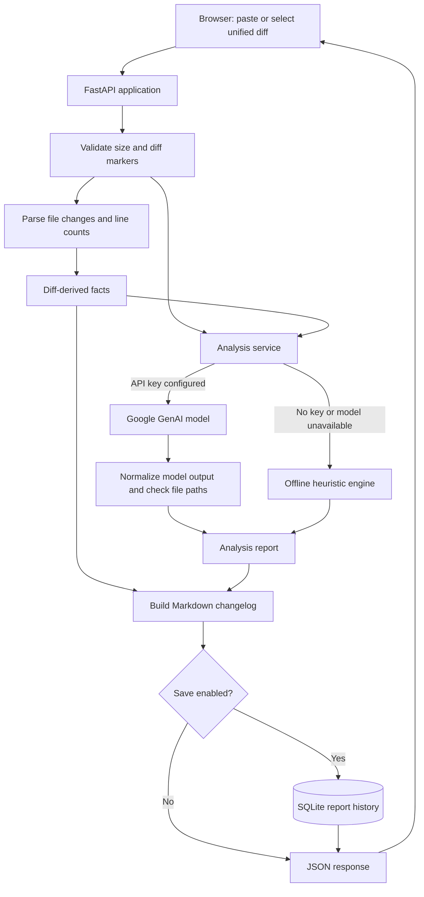

<div align="center">
  
  <h1>GemmaCommit Pulse</h1>
  <p><strong>Turn a Git diff into a reviewable change report.</strong></p>
  <p>Inspect what changed, assess potential risk, and produce a Markdown changelog—without confusing parsed facts for model-generated analysis.</p>
  <p>
    <a href="https://github.com/tahaullah-dev/gemma-commit-pulse"></a>
    
    
    
  </p>
  <p><a href="#getting-started">Run locally</a> · <a href="#api-reference">API reference</a> · <a href="#security-and-privacy">Security and privacy</a></p>
</div>

---

## What it does

Code review starts with a diff, but a large or unfamiliar change can be hard to triage quickly. GemmaCommit Pulse turns a unified Git diff into a compact report with file-level change counts, a risk assessment, categorized changes, review observations, and a Markdown changelog.

Its central distinction is **where each part of the report comes from**:

| Report section | Source | How to interpret it |
| --- | --- | --- |
| Changed files, statuses, additions, deletions, and hunks | Deterministic parsing of the submitted diff | Verifiable facts derived from the input |
| Summary, intent, categories, risk assessment, and review observations | Google GenAI model when configured; otherwise a local heuristic engine | Suggestions to review, not verified conclusions |
| Changelog | Application code combining the analysis and parsed facts | Generated Markdown; check it before publishing |

When AI analysis is enabled, the model's reported file paths are checked against the parsed file list and marked as verified or unverified in the API result. The UI presents the parsed file facts separately from the AI-inferred analysis.

## Preview

There is no hosted demo or screenshot in the repository yet. The application serves its browser interface from the same local server as the API; follow [Getting started](#getting-started) to try it. The interface accepts pasted diffs and `.diff` / `.patch` files, includes a sample diff, and can display, copy, and revisit saved reports.

## Features

- **Diff-derived facts:** file paths and statuses, additions, deletions, hunk counts, and totals are parsed from unified diff text.
- **AI-assisted review:** optional Google GenAI analysis returns a summary, inferred intent, risk score and level, confidence, change categories, security observations, potential bugs, and breaking-change notes.
- **Works without an API key:** a deterministic heuristic engine provides a basic report offline; it also serves as a fallback when model analysis is unavailable.
- **Model fallback configuration:** try an ordered list of model IDs if the primary model cannot be used.
- **GitHub-ready changelog:** create and copy Markdown assembled from the report and verified diff facts.
- **Local report history:** save, load, delete, and clear reports stored in SQLite.
- **Browser-based input:** paste a diff or select/drop a `.diff`, `.patch`, or `.txt` file (up to 5 MB in the browser).
- **No frontend build step:** FastAPI serves the static HTML, CSS, and JavaScript alongside the API.

> **Review aid, not an approval gate.** Risk scores and model-generated findings can be wrong or incomplete. Review the diff and validate important findings independently.

## How it works



The browser sends the diff to `POST /api/analyze`. The server validates and parses it, then combines the deterministic facts with either model analysis or a heuristic report. It builds a changelog, optionally persists the report, and returns the result as JSON. History operations use the same SQLite database.

## Technology

| Area | Technologies |
| --- | --- |
| API and application server | Python 3.10+, FastAPI, Uvicorn |
| Analysis | Google GenAI Python SDK; built-in deterministic heuristics as fallback |
| Persistence | SQLite |
| Browser interface | HTML, vanilla JavaScript, CSS, Tailwind CSS via CDN |
| Configuration | Environment variables; `python-dotenv` for `.env` loading |

## Project layout

```text
backend/
  main.py          FastAPI routes, request validation, frontend serving
  config.py        Environment-backed settings
  diff_parser.py   Unified-diff facts and heuristic analysis
  ai_service.py    Prompting, model retries, normalization, fallback
  changelog.py     Markdown changelog generation
  database.py      SQLite report history
frontend/
  index.html       Browser interface
  static/
    css/styles.css
    js/app.js       UI behavior and API requests
    favicon.svg
data/
  pulse.db         Default SQLite database path (created/initialized at startup)
Procfile           Process command for hosts that consume a Procfile
requirements.txt   Python dependencies
```

## Getting started

### Prerequisites

- Python 3.10 or newer.
- A Google AI Studio API key only if you want model-assisted analysis. Without a key, heuristic mode remains available.

### Install and run on Windows PowerShell

```powershell
git clone https://github.com/tahaullah-dev/gemma-commit-pulse.git
Set-Location gemma-commit-pulse

python -m venv .venv
.\.venv\Scripts\Activate.ps1
python -m pip install -r requirements.txt

Copy-Item .env.example .env
# Optional: edit .env and set GEMMA_API_KEY for model-assisted analysis.

python -m uvicorn backend.main:app --reload --port 8000
```

If PowerShell prevents virtual-environment activation, run the environment's Python directly instead:

```powershell
.\.venv\Scripts\python.exe -m pip install -r requirements.txt
.\.venv\Scripts\python.exe -m uvicorn backend.main:app --reload --port 8000
```

Open [http://localhost:8000](http://localhost:8000). FastAPI's interactive API documentation is available at [http://localhost:8000/docs](http://localhost:8000/docs).

### Install and run on macOS or Linux

```bash
git clone https://github.com/tahaullah-dev/gemma-commit-pulse.git
cd gemma-commit-pulse

python3 -m venv .venv
source .venv/bin/activate
python -m pip install -r requirements.txt

cp .env.example .env
# Optional: edit .env and set GEMMA_API_KEY for model-assisted analysis.

python -m uvicorn backend.main:app --reload --port 8000
```

### Configuration

Copy `.env.example` to `.env`. The settings module loads `.env` when `python-dotenv` is installed (it is included in `requirements.txt`). The key is optional.

| Variable | Default | Purpose |
| --- | --- | --- |
| `GEMMA_API_KEY` | Empty | Enables calls to the Google GenAI API when set. |
| `GEMMA_MODEL` | `gemma-3-27b-it` | Primary model ID. |
| `GEMMA_FALLBACK_MODELS` | `gemma-3-27b-it,gemini-2.0-flash` | Comma-separated fallback model IDs, attempted in order with duplicates removed. |
| `MAX_DIFF_CHARS` | `120000` | Maximum accepted diff size in characters. |
| `MAX_OUTPUT_TOKENS` | `4096` | Output-token limit supplied to the model. |
| `TEMPERATURE` | `0.2` | Generation temperature. |
| `REQUEST_TIMEOUT` | `60` | Model request timeout in seconds. |
| `DB_PATH` | `data/pulse.db` | SQLite database file path. |
| `HISTORY_LIMIT` | `25` | Reported by `/api/config`; the history endpoint itself defaults to 25 and accepts a limit up to 100. |

Start without `GEMMA_API_KEY` to use heuristic mode. Model availability and supported IDs depend on the configured Google GenAI service.

## Usage

1. Open the app and paste a unified diff, select a `.diff` / `.patch` file, or load the built-in sample.
2. Select **Analyze with Gemma**. The submit button works in heuristic mode too; an API key is needed only for model analysis.
3. Review the report. Diff facts are derived from the input; risk, summary, and findings are model-inferred or heuristic, depending on the mode.
4. Copy the generated changelog, or reopen a saved report from **Recent analyses**.

Generate a diff from your current branch, then paste or upload it:

```bash
git diff main...HEAD > change.diff
```

Replace `main` with the appropriate base branch. The browser file picker accepts `.diff`, `.patch`, and `.txt` files up to 5 MB; the API separately enforces `MAX_DIFF_CHARS`.

## API reference

The API is served by the same process as the browser application. Request and response bodies use JSON except for the static frontend.

| Method | Endpoint | Purpose |
| --- | --- | --- |
| `GET` | `/api/health` | Application version, AI-enabled status, and model IDs. |
| `GET` | `/api/config` | Current analysis and history configuration (does not return the API key). |
| `POST` | `/api/analyze` | Validate and analyze a unified diff; save by default. |
| `GET` | `/api/history?limit=25` | List recent saved reports; the requested limit is capped at 100. |
| `GET` | `/api/history/{analysis_id}` | Retrieve a saved report. |
| `DELETE` | `/api/history/{analysis_id}` | Delete one saved report. |
| `DELETE` | `/api/history` | Delete all saved reports. |

### Analyze a diff

```bash
curl -X POST http://localhost:8000/api/analyze \
  -H "Content-Type: application/json" \
  -d '{
    "diff": "diff --git a/README.md b/README.md\n--- a/README.md\n+++ b/README.md\n@@ -1 +1,2 @@\n Title\n+New line\n",
    "title": "Documentation update",
    "save": true
  }'
```

`diff` is required. `title` is optional and limited to 200 characters; when omitted, the server derives a title from the parsed files. `save` defaults to `true`.

An analysis response has this shape (values shortened; `id` is `null` when the report is not saved or persistence fails):

```json
{
  "id": 1,
  "created_at": "2026-01-01T12:00:00+00:00",
  "title": "Documentation update",
  "mode": "heuristic",
  "model": null,
  "notes": [],
  "facts": {
    "files": [
      {
        "path": "README.md",
        "old_path": null,
        "status": "modified",
        "additions": 1,
        "deletions": 0,
        "hunks": 1
      }
    ],
    "stats": {
      "files_changed": 1,
      "additions": 1,
      "deletions": 0,
      "hunks": 1,
      "chars": 97,
      "truncated": false
    }
  },
  "analysis": {
    "executive_summary": "...",
    "inferred_intent": "...",
    "risk_score": 23,
    "risk_level": "low",
    "confidence": "low",
    "affected_files": [
      {
        "path": "README.md",
        "change_type": "modified",
        "summary": "+1/-0 across 1 hunk(s)",
        "verified": true
      }
    ],
    "categories": [
      {
        "name": "docs",
        "items": ["README.md (modified, +1/-0)"]
      }
    ],
    "security_observations": [],
    "potential_bugs": [],
    "breaking_changes": []
  },
  "changelog": "# Documentation update\n..."
}
```

Possible validation errors include `400` for an empty or too-short diff, `413` when the character limit is exceeded, and `422` when the input does not look like a unified diff or contains no parsable files. Missing history records return `404`. FastAPI also validates the request body and the maximum title length.

## Security and privacy

- **Treat findings as suggestions.** The heuristic checks only selected patterns in added lines; it is not a comprehensive security scanner. Model output can also miss or invent concerns.
- **AI mode sends the submitted diff to Google GenAI.** Do not submit secrets or code you are not authorized to share with that provider. Heuristic mode does not make a model request.
- **History stores report data, not the original diff field.** The database persists parsed facts and generated analysis; those derived fields can still contain sensitive details from the diff.
- **The API has no authentication or authorization, and CORS allows all origins.** Do not expose an instance to an untrusted network without adding appropriate access controls and deployment hardening.
- Keep `.env` and API keys private; do not commit credentials.

## Deployment

The repository includes a `Procfile` that runs Uvicorn on `0.0.0.0:$PORT`, for platforms that support Procfile-based processes. Install `requirements.txt` and provide the runtime's `PORT`; configure `GEMMA_API_KEY` if model analysis is desired. The database defaults to `data/pulse.db`, so production deployments should verify that this path is writable and backed by persistent storage if reports must survive restarts.

No hosting provider configuration, deployment workflow, or public deployment URL is included in the repository. The development command above is for local use, not a production server configuration.

## Roadmap

No formal roadmap is currently documented. The following are **possible future improvements, not committed plans**:

- Add automated tests for diff parsing, API validation, and report persistence.
- Add authentication and configurable CORS before offering the API to untrusted users.
- Add a hosted demo and representative screenshots.
- Document a provider-specific production deployment and persistent database setup.

## Contributing

Contributions and issue reports are welcome:

1. Open an issue to describe a bug or proposed change.
2. Fork the repository and create a focused branch.
3. Make and manually verify your change locally; automated tests are not currently included in the repository.
4. Open a pull request with a clear summary and any relevant screenshots or reproduction steps.

Please do not include API keys, real credentials, or private diffs in issues, pull requests, or sample data.

## License

No license file is present in this repository. Until the maintainers add one, do not assume that the code is licensed for reuse or redistribution.

## Acknowledgements

Built with [FastAPI](https://fastapi.tiangolo.com/), [Uvicorn](https://www.uvicorn.org/), the [Google GenAI Python SDK](https://github.com/googleapis/python-genai), and SQLite. The browser UI uses [Tailwind CSS](https://tailwindcss.com/) from its CDN.

---

<div align="center">
  <strong>Make the diff easier to understand. Keep the final review human.</strong>
  <br>
  <a href="https://github.com/tahaullah-dev/gemma-commit-pulse">Explore the repository</a> ·
  <a href="https://github.com/tahaullah-dev/gemma-commit-pulse/issues">Report an issue</a>
</div>
